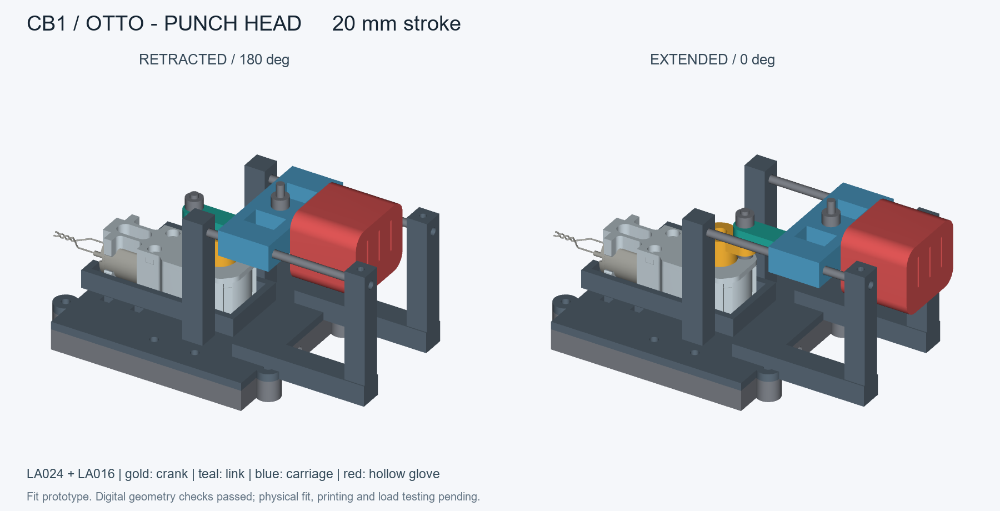
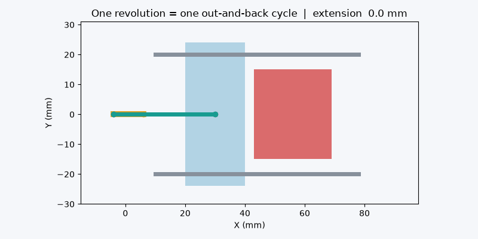

# 出拳机器人头部建模详细说明（团队同步版）

版本：v01  
整理日期：2026-09-28  
项目：milk组桌面双足对战机器人  
模型位置：`04_结构与硬件/Otto_CB1出拳头部_v01/`



## 1. 本文用途

本文用于向小组成员同步出拳机器人头部的设计目标、机构方案、建模依据、参数、打印件、装配方式、控制要求、验证结果和后续任务。

当前项目计划为两台机器人：

- 机器人A：头顶旋转巴掌，机械功能已实现。
- 机器人B：头顶直线出拳机构，使用CyberBrick 1.0套件中的直流电机，通过机械结构完成拳头打出与收回，并由手柄控制。

本文所述出拳头部已经完成参数化建模和数字几何检查，但尚未打印、装配和通电测试。因此，当前可以表述为“出拳头部v01数字样机已完成”，不能表述为“实物出拳功能已经实现”。

## 2. 最终采用的机构方案

设计采用水平布置的曲柄滑块机构：

`LA024直流电机 → LA016减速齿轮组 → 双扁孔曲柄 → 连杆 → 双导杆滑架 → 空心拳套`

工作过程如下：

1. 直流电机持续向同一方向转动。
2. LA016齿轮组把电机的高速旋转减速后输出。
3. 输出轴带动曲柄在水平面内旋转。
4. 曲柄通过连杆推动滑架前后移动。
5. 拳套安装在滑架前端，因此会沿机器人正前方打出并收回。
6. 曲柄每转一圈，拳头完成一次完整的“打出—收回”循环。

默认曲柄半径为10 mm，因此理论总行程为20 mm。机构运动预览见：



采用曲柄滑块方案的原因：

- 能用普通连续旋转直流电机实现自动往复。
- 不需要每次出拳都切换电机正反转。
- 结构原理清楚，便于打印、装配和调参。
- 使用双金属导杆承担拳头运动中的侧向力，减少电机轴和连杆承受的弯曲载荷。
- 允许后续增加原位检测，实现“按一下只出一拳并停在收回位置”。

本版参考了James Bruton / XRobots Punchy的电机、齿轮和连杆出拳思路，但所有适配Otto头部的零件均重新建模，没有直接复制Punchy的轮式底盘、双拳结构或原始零件。

## 3. 电机和减速器依据

建模基准为CyberBrick 1.0套件中的：

| 部件 | 型号 | 当前状态 |
|---|---|---|
| 030有刷直流电机 | LA024 | 用户确认手头有CB1电机，实物标签仍需核对 |
| 单轴减速齿轮组 | LA016，1:48 | 按官方套件资料建模，手头是否配齐和装好仍需核对 |

官方资料给出的LA024主要信息：

- 额定电压：8.0 V DC。
- 使用电压范围：5.0–9.0 V DC。
- 空载转速：10500 ±10% rpm。
- 额定负载转速：6900 ±10% rpm。
- 空载电流：最大45 mA。
- 额定负载电流：最大150 mA。
- 启动电流：最大350 mA。
- 裸电机重量：约22 g。

如果仅用空载转速除以48，减速后的理论空载输出约为219 rpm，即约3.65圈/秒。由于一圈对应一次往复，这个速度对首轮测试可能偏快。实际速度还会受到齿轮效率、负载、摩擦、电池状态和PWM占空比影响，因此不能直接把理论值当作实机速度，也不能据此计算或宣称出拳力量。

减速器官方STEP模型的外壳总包络约为：

- 长度：54.35 mm。
- 宽度：22 mm。
- 厚度：18 mm。
- 输出轴外伸约8.1 mm。
- 输出端为带两个相对平面的双扁轴，不是普通圆轴。

曲柄中心孔没有凭经验画成圆孔或单D孔，而是从官方STEP中截取真实输出轴外轮廓，再增加0.15 mm单边配合间隙生成。

## 4. 与Otto身体的接口

项目已有Otto身体顶部的已知外包络为69×69 mm。本版延续此前巴掌模块的安装基准：

- 身体外宽：69 mm。
- 安装圈单边间隙：0.4 mm。
- 安装圈净开口：69.8×69.8 mm。
- 安装平台名义宽度：75 mm。
- 安装圈向下包住身体8 mm。
- 身体侧面固定孔中心位于身体上沿下方4 mm。

安装结构被拆成两件：

1. `09_body_collar`：套在Otto身体顶部的安装圈。
2. `01_mount_and_guides`：上方平台、减速器托盘和导杆支座。

两件通过四组M3螺钉和螺母连接。这样可以避免在69.8 mm的大空腔上方直接打印一整片悬空顶板，也方便拆卸电机和维护传动机构。

需要注意：模型使用的是Otto身体外包络和已有接口记录，尚未检查当前实物内部的主板、电池、线材以及已有钻孔是否与模型完全相符。第一次装配前必须用量规和实物核对。

## 5. 坐标、尺寸与运动范围

建模坐标约定：

- X正方向：拳头向前打出的方向。
- Y方向：机器人左右方向。
- Z正方向：向上。
- Otto身体顶部平面：Z=0。

默认几何参数：

| 项目 | 默认值 | 说明 |
|---|---:|---|
| 曲柄半径 | 10 mm | 决定一半行程 |
| 总行程 | 20 mm | 等于曲柄直径 |
| 连杆两孔中心距 | 34 mm | 控制连杆倾角和滑架位置 |
| 曲柄轴中心X坐标 | 6 mm | 相对Otto身体顶部中心 |
| 滑架铰点范围 | X=30–50 mm | 收回至打出的运动范围 |
| 拳套最前端范围 | X=69–89 mm | 默认模型包络 |
| 导杆直径 | 3 mm | 使用光滑金属杆 |
| 导杆长度 | 64 mm | 沿X方向安装 |
| 两导杆中心距 | 40 mm | 分别位于Y=±20 mm |
| 滑架导孔直径 | 3.45 mm | 含0.45 mm直径方向运行间隙 |
| 固定支座孔直径 | 3.15 mm | 含0.15 mm直径方向固定间隙 |
| 转动副通孔 | 3.2 mm | 配合M3紧固件 |
| 最大连杆偏角 | 约17.1° | 默认20 mm行程下的几何结果 |
| 模块最高点 | 约Z=58.8 mm | 不含未知外部线材和传感器 |

滑架位置采用标准曲柄滑块关系：

```text
s = cx + r*cos(theta) + sqrt(L² - r²*sin²(theta))
```

其中：

- `s`为滑架铰点的X位置。
- `cx`为曲柄轴中心X位置。
- `r`为曲柄半径。
- `L`为连杆两孔中心距。
- `theta`为曲柄角度。

在本模型中：

- `theta = 180°`：拳头完全收回。
- `theta = 0°或360°`：拳头完全打出。
- 电机连续同向旋转时，拳头会周期性往复。

## 6. 参数化脚本的组织方式

主脚本为 `build_punch_head.py`。脚本主要完成以下工作：

1. 读取`parameters.json`中的参数。
2. 导入官方LA024电机和LA016减速器STEP参考模型。
3. 检查官方STEP实体数量和外壳尺寸，避免导入错误版本后继续生成。
4. 从官方输出轴截面生成曲柄双扁孔。
5. 创建安装圈、平台、导杆座、曲柄、连杆、滑架、拳套、传感器支架和两个量规。
6. 根据曲柄角度计算活动零件位置。
7. 检查零件是否为有效实体、STL是否闭合。
8. 离散采样整个运动周期，检查活动件与固定件之间的体积干涉。
9. 导出STL、STEP、GLB、预览图、动画、运动CSV和验证JSON。

脚本只进行CAD生成和数字验证，不连接CB1，也不会驱动电机。

默认运行方式：

```powershell
python .\build_punch_head.py
```

指定参数和检查步长：

```powershell
python .\build_punch_head.py --config .\parameters.json --out .\output --angle 180 --sweep-step 5
```

参数说明：

- `--config`：指定参数JSON。
- `--out`：指定输出目录。
- `--angle`：额外输出指定角度的总装模型。
- `--sweep-step`：干涉检查的角度间隔，必须大于0且不超过15°。
- `--skip-render`：跳过PNG和GIF渲染，但仍执行几何检查。

脚本已经在Windows、Python 3.11.5、CadQuery 2.8.0环境运行通过。项目原有`cad_runtime`虚拟环境记录了旧电脑路径，因此脚本会直接复用其中的Python包；换电脑时可以根据`requirements.txt`建立新的环境。

## 7. 参数文件及可调范围

`parameters.json`保存当前默认值。较常用的参数如下：

| 参数名 | 默认值 | 当前脚本允许范围或说明 |
|---|---:|---|
| `crank_radius_mm` | 10 | 10–12 mm，即20–24 mm总行程；更小半径要重做轴套与螺钉避让 |
| `rod_centres_mm` | 34 | 32–36 mm |
| `body_outer_mm` | 69 | 依据现有身体记录，改变后需重新设计接口 |
| `body_fit_per_side_mm` | 0.4 | 安装圈单边间隙 |
| `shaft_socket_radial_clearance_mm` | 0.15 | 曲柄对双扁轴的单边间隙，脚本允许0.05–0.30 |
| `guide_rod_diameter_mm` | 3 | 脚本允许2.5–4 mm，但支座和五金需同步更换 |
| `guide_y_mm` | 20 | 单侧离中心距离，脚本允许19–22 mm |
| `guide_running_diametral_clearance_mm` | 0.45 | 脚本允许0.2–0.8 mm |
| `guide_fixed_diametral_clearance_mm` | 0.15 | 固定孔直径方向间隙 |
| `pivot_hole_diameter_mm` | 3.2 | M3转轴通孔 |
| `fist_socket_per_side_mm` | 0.25 | 拳套与腕部舌头单边间隙 |

参数化只表示这些尺寸可由脚本统一修改，不表示所有数值组合都可用。脚本包含行程边界和壁厚检查，会拒绝明显不合理的组合。每次改动参数后都要重新生成、重新检查，并根据需要重新打印量规。

## 8. 打印件清单与作用

### 01 安装平台、减速器托盘与导杆座

文件：`01_mount_and_guides.stl`

作用：

- 承载减速器。
- 支撑两根金属导杆。
- 提供前后导杆支座。
- 通过外耳与身体安装圈连接。
- 通过两个扎带通槽固定减速器壳体。

减速器托盘按官方壳体包络预留约0.3 mm横向间隙；后方设有电机线出口。导杆前端支座带M3紧定螺钉底孔，后端使用盲孔定位。

### 02 双扁孔曲柄

文件：`02_crank_keyed_hub.stl`

作用：把减速器输出轴的旋转传给连杆。曲柄中心使用官方输出轴截面生成的双扁孔，外侧带中心锁紧螺钉避让孔；偏心端为M3连杆转轴孔。

首次打印前先打印08号轴孔量规，确认间隙合适。不能通过整体缩放曲柄修正轴孔，否则曲柄半径和转轴尺寸也会同时变化。

### 03 连杆

文件：`03_connecting_rod.stl`

两孔中心距默认34 mm，一端连接曲柄，另一端连接滑架。连杆和曲柄、滑架之间通过2 mm间隔垫错层，避免运动时互相摩擦。

### 04 滑架与腕部

文件：`04_carriage_and_wrist.stl`

滑架同时承担三项功能：

- 通过两个孔沿Ø3金属导杆滑动。
- 中部M3孔与连杆连接。
- 前端舌头连接拳套。

滑架孔必须清理平滑。首次装配时应能手动沿导杆完整移动，不应靠电机强行克服卡滞。

### 05 空心拳套

文件：`05_hollow_boxing_glove_TPU.stl`

拳套为可拆空心结构，前端使用圆角，底部设有清理和排气开口。设计优先考虑TPU等柔性材料；PLA可先做尺寸样件，但不建议作为最终对战接触面。

拳套通过腕部舌头和一组M3螺钉固定，损坏后可单独更换。

### 06 可选传感器支架

文件：`06_optional_sensor_bracket.stl`

用于未来安装霍尔、光电或机械原位传感器。当前仅为通用开槽支架，没有选定具体传感器，也没有触发片，因此不表示回位检测已经完成。

### 07 身体开口量规

文件：`07_body_fit_gauge.stl`

用于低成本确认69.8 mm净开口是否能正常套入现有Otto身体。量规通过后再打印完整安装件。

### 08 输出轴孔量规

文件：`08_output_shaft_fit_gauge.stl`

用于确认减速器双扁输出轴和曲柄孔的配合。理想状态为能够手推装入、不会明显空转，也不需要敲击安装。

### 09 身体安装圈

文件：`09_body_collar.stl`

套在Otto身体顶部，向下包住身体8 mm。外侧四个连接耳带M3六角螺母窝，用于连接上方平台。

## 9. 需要准备的非打印零件

除CB1电机和减速齿轮组外，还需要：

| 名称 | 数量 | 规格建议 | 用途 |
|---|---:|---|---|
| 光滑金属导杆 | 2 | Ø3×64 mm | 滑架导向；不使用全螺纹杆代替 |
| 曲柄端低头螺钉 | 1 | M3×16 | 曲柄与连杆转轴 |
| 滑架端低头螺钉 | 1 | M3×25 | 连杆与滑架转轴 |
| 2 mm间隔垫 | 2 | 外径≤6 mm、内孔约3.2 mm | 给连杆提供轴向错层 |
| M3防松螺母 | 2 | 外包络≤6.4 mm、高约4 mm | 两个运动转轴 |
| M3薄垫圈 | 2 | 外径≤6.4 mm | 转轴顶部 |
| 拳套固定件 | 1套 | M3×20、垫片和螺母 | 固定拳套 |
| 平台连接螺钉 | 4 | M3×12 | 连接01和09 |
| 平台连接螺母 | 4 | 普通M3六角螺母 | 装入09的螺母窝 |
| 导杆紧定螺钉 | 2 | M3×6 | 固定导杆前端 |
| 输出轴锁紧螺钉 | 1 | 以实物输出轴中心孔为准 | 固定曲柄，不能从CAD避让孔反推牙距 |
| 尼龙扎带 | 2 | 约2.5 mm宽 | 固定减速器壳体 |
| 身体固定件 | 2套 | M3，长度按实物确定 | 固定安装圈和身体 |
| 原位传感器 | 未来1套 | 尚未选型 | 实现单击一拳后自动归位 |

完整采购与实收核对表见`BOM.csv`。

## 10. 建议打印顺序

第一阶段先验证尺寸：

1. 打印07身体开口量规。
2. 打印08输出轴孔量规。
3. 分别试装Otto身体和LA016输出轴。
4. 记录偏紧、偏松、是否需要局部孔补偿。

第二阶段验证机构：

1. 打印01、02、03、04和09。
2. 准备两根Ø3×64 mm导杆和转轴紧固件。
3. 暂不安装拳套，手动转动曲柄检查完整一圈。
4. 确认滑架不夹紧、连杆不碰支座、紧固件不扫到其他零件。

第三阶段增加接触件：

1. 用PLA打印05检查尺寸。
2. 确认拳套与腕部连接后，再用TPU打印接触版本。
3. 在独立台架低速驱动，不先安装到双足机器人上。

硬质结构试装可以PLA或PETG、0.2 mm层高、3–4圈墙作为起点。正式填充、支撑、孔补偿和TPU参数需要根据实际打印机确定。本项目没有生成特定打印机的3MF或G-code。

## 11. 建议装配顺序

1. 核对实物标签，确认电机和齿轮组确实是LA024与LA016。
2. 按官方说明装好减速齿轮箱。
3. 使用07、08两个量规检查身体接口和输出轴接口。
4. 把09安装圈套在Otto身体上，检查与内部电子元件是否干涉。
5. 预穿两根扎带，把01平台用四组M3×12和M3螺母固定在09上。
6. 把减速器放入托盘，使用扎带固定；电机线从后部开口引出。
7. 将02曲柄装到双扁输出轴上，用与实际输出轴中心孔匹配的螺钉锁定。
8. 两根导杆从前端穿入，依次穿过滑架并插入后方盲孔。
9. 调整滑架，确认其能手动顺畅移动，再锁定导杆紧定螺钉。
10. 使用M3×16、间隔垫、垫圈和防松螺母连接曲柄与连杆。
11. 使用M3×25、间隔垫、垫圈和防松螺母连接连杆与滑架。
12. 调整两个转轴螺母：应消除明显松旷，同时允许连杆自由转动，不能夹死。
13. 把拳套套到腕部舌头，用M3×20组件固定。
14. 不通电手动转动完整一圈，检查卡滞、干涉、螺钉松动和电线位置。
15. 通过手动检查后，才进行独立台架低速通电测试。
16. 台架通过后装到机器人，再重新验证站姿、行走、顶部重心和出拳反作用。

## 12. 手柄控制逻辑

本轮只完成机械建模，没有修改或上传CB1程序。LA024后续可接入接收板的M1或M2直流电机口，四个腿部舵机口继续用于行走。

可以分两个控制阶段：

### 阶段A：按住连续出拳

- 按住指定手柄输入：电机按设定速度持续同方向旋转。
- 拳头连续完成打出和收回。
- 松开：立即停止电机。
- 局限：松开时电机可能停在任意角度，拳头可能停在半程。

此模式机械和软件都较简单，适合第一轮低速台架测试。

### 阶段B：单击一拳并自动收回

需要增加原位传感器，推荐的状态过程为：

1. 待机时传感器确认拳头在收回原位。
2. 收到一次攻击命令后启动电机。
3. 曲柄离开原位，系统记录已经开始一圈运动。
4. 曲柄转一圈后再次进入原位。
5. 立即停止电机，完成一次出拳。
6. 如果在限定时间内没有返回原位，进入故障并停机。

需要保留的安全逻辑：

- K4继续作为停止，不能同时兼任攻击。
- 失联立即停止电机。
- 故障后不能自动重新出拳，需要显式恢复。
- 行走与攻击是否允许同时进行，应在整机负载测试后决定。
- 任何情况下都不要为了强制收回而在失联或卡滞后继续驱动。

## 13. 已完成的数字验证

最终默认版本执行了：

```powershell
python build_punch_head.py --sweep-step 10
```

结果：

- 脚本正常结束，状态为`DIGITAL_CHECKS_PASS_PHYSICAL_UNVERIFIED`。
- 9个自建打印件均为单一有效BRep实体。
- 9个STL均为闭合网格、正体积、单一连通体。
- 0–360°每10°采样，共37个运动位置。
- 所检查的活动件之间没有发现体积重叠。
- 所检查的活动件与固定件之间没有发现体积重叠。
- 新建固定件与官方电机/减速器外壳包络之间没有发现体积重叠。
- 已导出收回和打出两个极限位置的STEP、GLB和预览图。
- 已生成俯视运动GIF和运动数据CSV。

另外测试了24 mm行程变体：曲柄半径改为12 mm，在0/90/180/270/360°五个关键位置没有发现所检查的干涉。24 mm版本只做了关键角度检查，不等同于默认20 mm版本的整圈密集检查。

数字验证过程中修正了四个问题：

- 拳套圆角导致导出网格不闭合，改为沿X方向圆角后通过检查。
- 官方电机后部线材与托盘后壁存在约0.145 mm³重叠，扩大走线口后通过检查。
- 原一体式平台存在大面积悬空顶板，改为平台与安装圈分件。
- 扎带缺少清晰装配路径，改为穿过平台的通槽。

详细记录见`验证记录_2026-09-28.md`和`output/validation.json`。

## 14. 数字验证没有证明什么

当前结果没有证明以下事项：

- 实际打印公差一定合适。
- 输出轴量规一定能套入实物。
- 当前实物一定配齐LA016齿轮和正确外壳。
- 金属导杆与滑孔的真实摩擦足够小。
- 螺纹、扎带和所有实际紧固件不会干涉。
- 电机线在运动中不会被卷入曲柄。
- 结构强度、疲劳寿命和跌落耐久性足够。
- 20 mm行程一定有足够的视觉效果或击打效果。
- 电机扭矩一定能克服滑架和拳套负载。
- 安装头部后Otto仍能稳定站立或行走。
- 手柄控制、失联停机和单拳回位已经实现。
- 拳套适合与人体接触；项目测试应只对柔软目标和另一台轻量机器人进行。

因此，接下来的重点不是直接开始正式对战，而是先完成尺寸量规、手动机构和独立低速台架三个验证阶段。

## 15. 文件夹内主要文件

| 文件或目录 | 用途 |
|---|---|
| `出拳机器人头部_建模详细说明_团队同步版.md` | 本文，组内同步入口 |
| `README_建模与装配.md` | 操作和装配说明 |
| `build_punch_head.py` | 参数化建模及数字验证脚本 |
| `parameters.json` | 默认参数 |
| `BOM.csv` | 打印件和五金清单 |
| `资料核对与设计依据.md` | 官方资料、测量和设计选择依据 |
| `验证记录_2026-09-28.md` | 数字检查记录及边界 |
| `output/STL_打印件/` | 9个打印件STL |
| `output/STEP_可编辑实体/` | 9个可编辑STEP实体 |
| `output/assembly_180deg.step` | 收回状态总装 |
| `output/assembly_000deg.step` | 打出状态总装 |
| `output/assembly_preview.png` | 收回/打出预览 |
| `output/mechanism_motion.gif` | 运动动画 |
| `output/motion.csv` | 角度和位移数据 |
| `output/validation.json` | 几何验证报告 |
| `Otto_CB1出拳头部_v01_建模包.zip` | 现有建模交付压缩包；创建时间早于本文，分享单个压缩包前需重新打包 |

## 16. 建议的小组分工

| 工作 | 建议负责人 | 需要形成的记录 |
|---|---|---|
| 核对LA024、LA016和输出轴 | 硬件成员 | 实物照片、标签和数量 |
| 打印07、08量规 | 打印成员 | 松紧、孔尺寸和修改量 |
| 准备导杆与M3五金 | 结构成员 | 实收数量和实际尺寸 |
| 机构试装 | 结构成员 | 手动整圈是否顺畅、干涉点 |
| 电机口低速测试 | 控制成员 | PWM、方向、起动能力和停止行为 |
| 原位传感器选型 | 结构＋控制成员 | 型号、安装位置、输入接口 |
| 手柄攻击映射 | 控制成员 | 使用哪个输入、停止优先级 |
| 整机站姿和行走复测 | 结构＋控制成员 | 加装前后对比、视频和参数版本 |
| 对战体验测试 | 体验成员 | 动作是否清楚、节奏、误操作和安全观察 |

## 17. 下一次小组碰头需要确认

1. 手头马达是否明确标为LA024。
2. 是否有完整LA016 1:48齿轮包、轴和上下壳体。
3. 实物减速器输出轴是否与官方STEP一致。
4. 能否准备两根Ø3×64 mm光滑金属导杆。
5. 现有M3五金是否满足BOM，特别是低头螺钉和防松螺母。
6. 首轮拳套是先用PLA做尺寸样件，还是直接使用TPU。
7. 手柄上哪个输入分配给攻击；K4继续保留为停止。
8. 第一轮是否先采用“按住连续出拳”，再做原位传感器和单击一拳。
9. 20 mm行程是否先做基线；若视觉效果不足，再验证24 mm变体。

## 18. 推荐的下一阶段通过标准

只有依次满足下面条件，才进入下一阶段：

### 尺寸关口

- 07量规能自然套入Otto身体。
- 08量规能装入减速输出轴且无明显空转。
- 减速器能放入托盘，电机线能顺利引出。

### 手动机构关口

- 滑架能沿两根导杆手动全程移动。
- 手转曲柄一圈无卡滞和硬碰撞。
- 两个连杆转轴无明显松脱，也没有被螺母夹死。

### 独立台架关口

- 不装机器人腿部时，低速连续完成至少10次往复。
- 电机、齿轮、曲柄和滑架无明显发热、松动或异常声响。
- 松开控制后电机确实停止。

### 整机关口

- 安装头部后机器人能够稳定站立。
- 加装前后行走表现有记录可比较。
- 出拳时机身不会持续倾倒或产生不可控跳动。
- K4停止和失联停止均有效。

完成这些关口后，才能把状态更新为“实物出拳机构已实现”，再进入连续对战和用户体验测试。

