# 主板与攻击模块逐步装配
按M01–M05→蓝B/红R→Z01进行。身体铜螺母预装位置见图解A01、A02。

## M01 在桌上先把主板固定到托架

准备：外径2.5×8mm塑料自攻螺丝 ×4

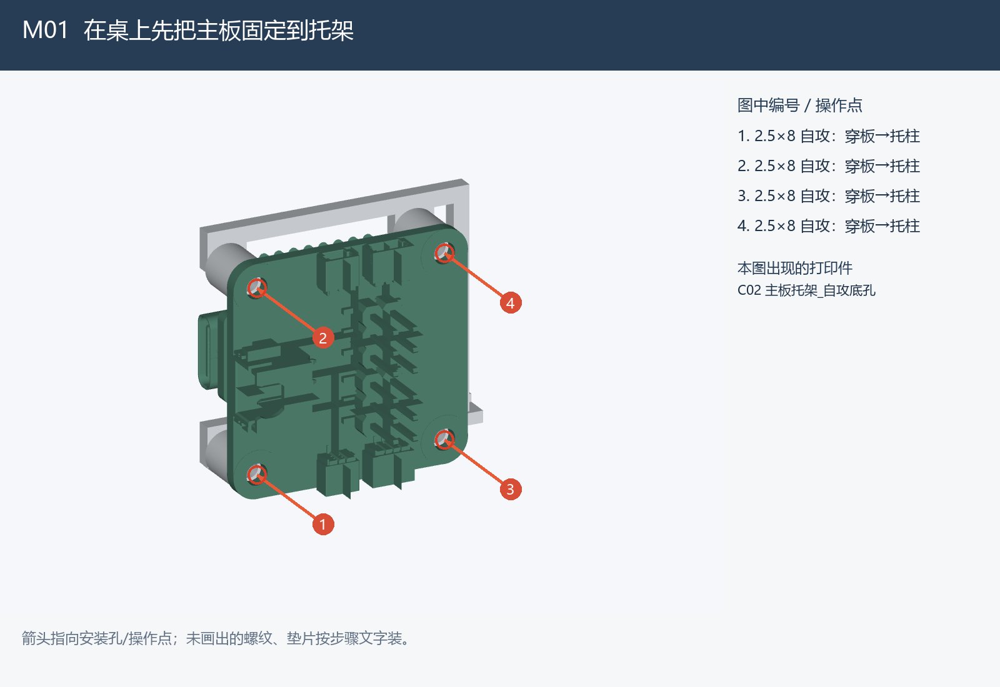

1. 拿 C02 托架和接收主板组合，四个板孔与四根托柱对齐。USB 插口最终朝身体后面的开口。
2. 从电路板一侧穿过板孔，向塑料托柱拧入4颗自攻；先四颗轻带上，再交替贴紧。
3. 螺丝头不能压电路元件，板不能被拧弯。本包托架是Ø2.1底孔版本。

装完检查：四角固定平整；USB插头可插拔。
不是 M2.5 机牙螺丝，也不是 M3。本图使用送印包内修正过的 C02。

## M02 主板托架落进身体定位柱

准备：本步不加螺丝

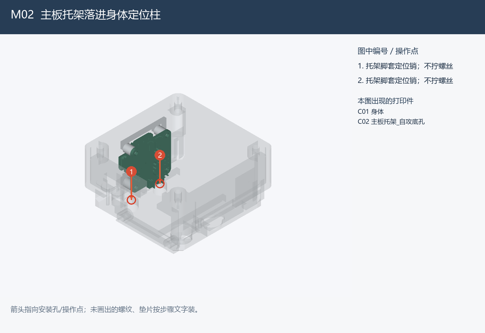

1. 从身体顶部放入主板+托架，托架底部两孔套到身体内两根定位销。
2. 确认两只脚都落到底，USB朝后，线束从侧面空隙经过。
3. 上方攻击模块装好后会限制托架上抬；此刻不要强行给底脚另打螺丝。

装完检查：托架坐到底，不挤髋舵机，不堵后方USB口。
图中托架抬高15mm显示安装路径；装完必须落到底。

## M03 开关先拧在后面板上

准备：外径2.5×6mm塑料自攻螺丝 ×1

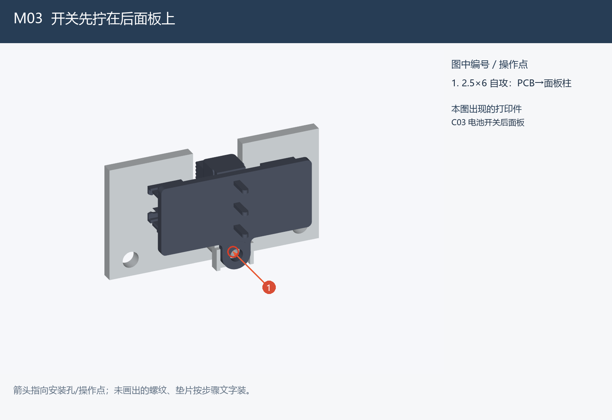

1. 在桌上拿 C03 面板与 XA007 开关，把拨杆放进面板上端敞开的U形槽。
2. 开关PCB下方安装耳贴住面板内侧圆支柱；从PCB一侧拧1颗2.5×6自攻进支柱。
3. 按实际输入/输出标识先插好两端电源线，再把开关来回拨到底检查；不可夹住拨杆。

装完检查：开关不晃、拨动顺畅，两端插头完全插入。
这颗细孔固定开关PCB；下一步两颗M3才固定整块后面板。

## M04 整块后面板从背后锁到身体

准备：M3×8 半圆头螺钉 ×2

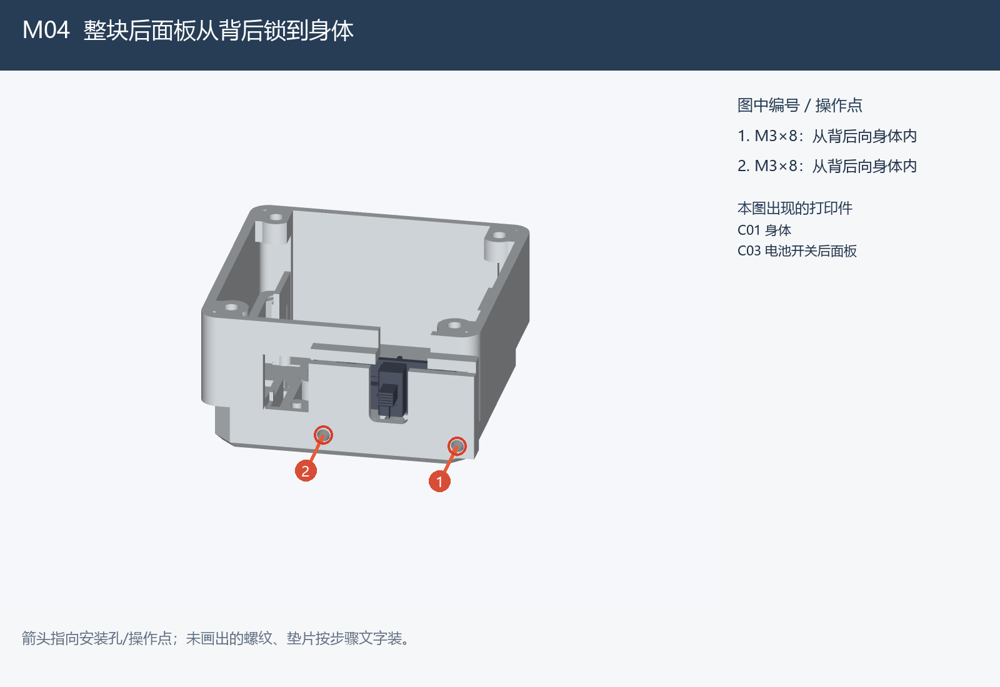

1. 将开关线先送入身体内部，把C03贴到身体后方对应面。
2. 从身体外后方，把两颗M3×8穿过面板左右孔，拧入准备时已装的铜螺母。
3. 两颗交替拧到贴合即可，不能靠螺丝挤压夹在缝里的导线。

装完检查：后面板贴平，开关到底仍不卡，线没有夹在板缝。

## M05 放电池、接线，然后再封顶

准备：电池 ×1；理线带少量；不新增结构螺丝

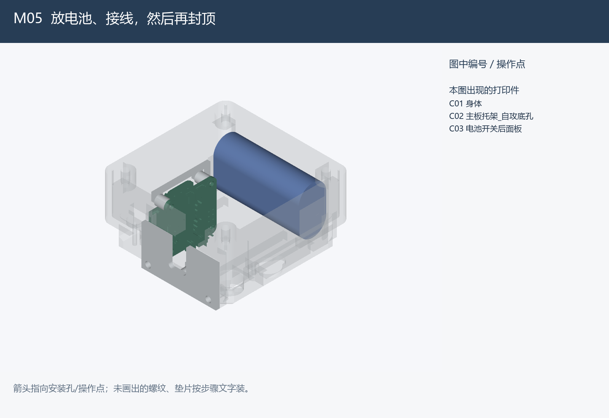

1. 电池竖放在身体前部的限位空间，线路走两侧，不放进腿轴活动区。
2. 按模块标识接：电池→XA007开关→接收板电源；S1左髋、S2左踝、S3右髋、S4右踝，左右均按机器人自身。
3. 攻击线提前留到顶部：蓝机用已验证的D1舵机转接线，红机用M1电机线。先确认极性，不能只按线颜色猜。
4. 插一次USB检查开口。盖上前逐根确认线在内部走线口中，没有压在身体/头部接缝。

装完检查：电池、主板不松，开关可操作；拔插USB无需拆头。
后方USB已确认用于数据；不要据此认为接上USB就能给电池充电。充电按原电池/充电器方式。

## B01 承重座先装两颗盖子铜螺母

准备：M3热熔铜螺母 ×2

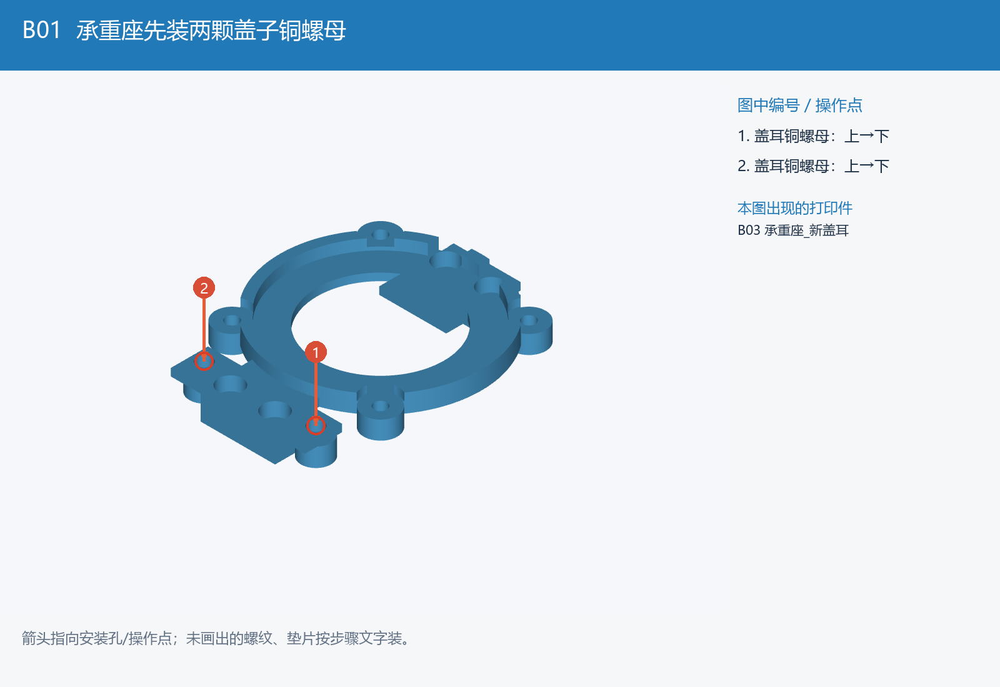

1. 拿B03承重座，找到后侧两个较小的盖耳，不是外周四个压环螺母槽。
2. 由上向下热装两颗铜螺母，冷却；位置见图1、2。
3. 至此一台蓝机共用了8颗热熔铜螺母：身体6颗、承重座2颗。

装完检查：两颗顶面齐平、轴线竖直。

## B02 底座侧槽先塞入四颗普通螺母

准备：M3普通六角螺母 ×4

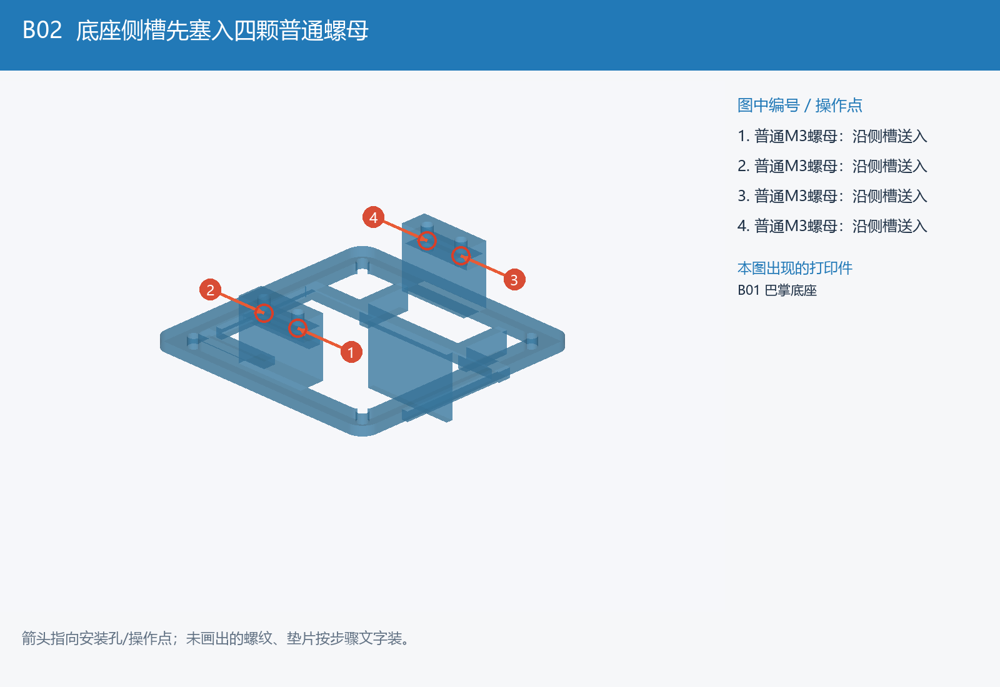

1. 拿B01底座，找到两根支柱侧面的水平螺母槽；每根柱的槽里放两颗普通M3螺母。
2. 从侧边推入普通M3六角螺母，让其螺纹孔与上方竖孔同轴。
3. 用待会使用的M3螺丝轻试能起牙后退出；本步不要装桥和上盖，以免堵槽。

装完检查：4颗均到底、没有斜卡；这些不是热熔铜螺母。

## B03 承重座底面预装四颗压环螺母

准备：M3普通六角螺母 ×4

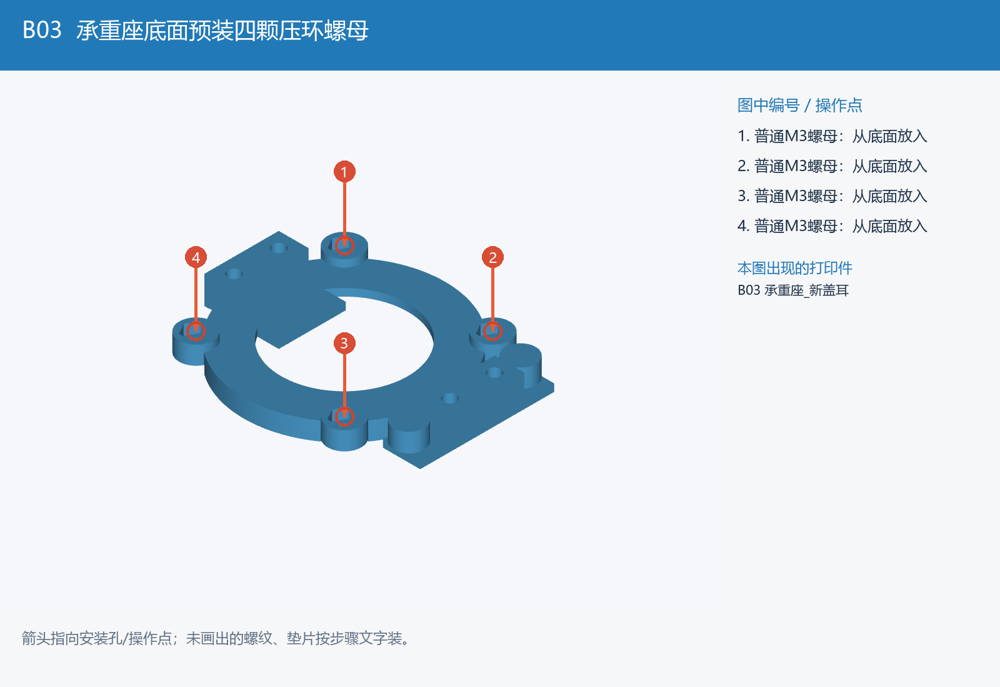

1. 把B03翻过来，找到外周四个六角槽；图为底面观察。
2. 普通M3六角螺母分别塞到底，让孔与上方压环螺孔同轴。
3. 先轻试螺丝起牙再退出，避免后面装完盖子才发现漏放。

装完检查：普通螺母累计8颗：底座4颗，承重座底面4颗。

## B04 把连续旋转舵机装在舵机桥上

准备：攻击用连续旋转舵机 ×1；匹配原配安装小螺丝 ×2

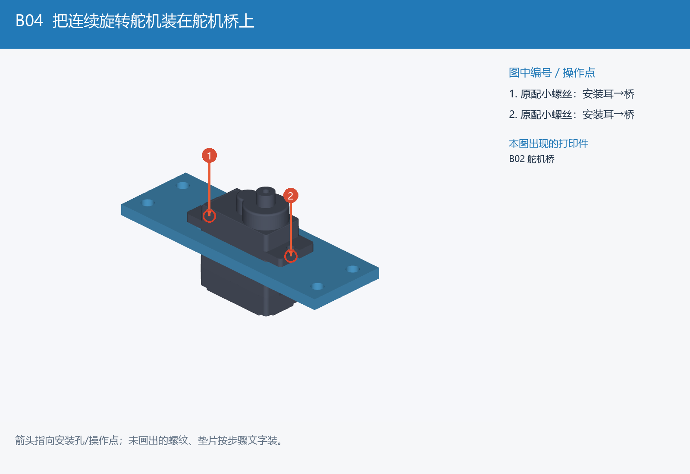

1. 将舵机从B02桥的矩形孔穿入，轴朝上，壳体垂在桥下面。
2. 两个安装耳对齐桥上的两只小孔，使用与实际舵机匹配的原配安装小螺丝锁住。
3. 把线引向下方，先不装B07转盘；舵盘花键需与实物一致。

装完检查：舵机壳固定、输出轴向上，线不被桥夹住。
此处模型孔Ø2.4只提供安装位置，不代表可以换M3；若新舵机耳孔/花键不同，要先试配。

## B05 承重座、舵机桥、底座锁成一组

准备：M3×14 半圆头螺钉 ×4；使用步骤B02已预放的4颗螺母

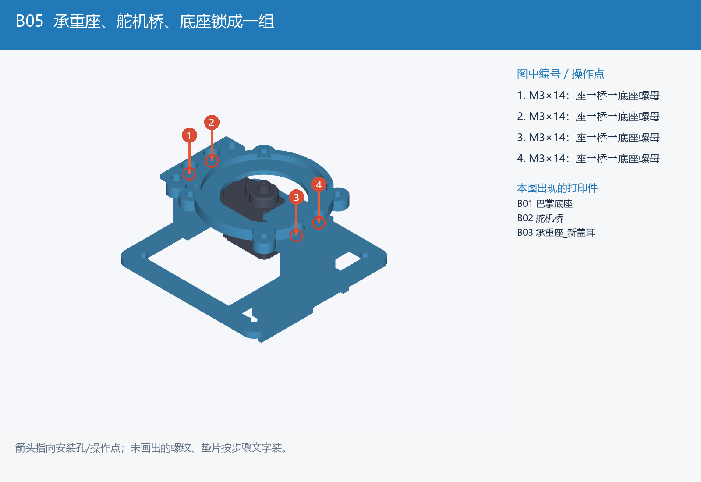

1. 将B02舵机桥放在B01支座上，再把B03承重座放到桥上方，四孔对齐。
2. 从B03的四个下沉座面向下插M3×14，依次穿过承重座与桥，拧入B01的普通螺母。
3. 先四颗都起牙，再交替拧紧；不要先上转盘挡住工具。

装完检查：三个件贴合，四个螺丝头低于转盘运动空间。
使用低头/半圆头；高圆柱头可能顶到转盘。

## B06 圆肩盖罩上，只锁后侧两个孔

准备：M3×8 半圆头螺钉 ×2

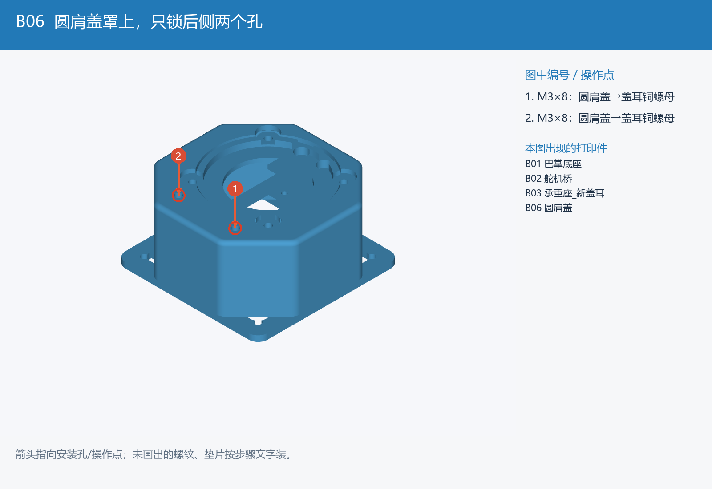

1. 将B06圆肩盖从上方罩住机构，顶部圆孔对准承重座环口。
2. 后侧两孔各用1颗M3×8，向下拧入B01步骤装好的两颗铜螺母。
3. 身体四角安装孔此时仍露在盖子外；不要把这四孔当作本步盖子孔。

装完检查：盖子贴合，无线卡在下边缘；顶盖两颗螺丝就位。

## B07 舵盘嵌进转盘槽，再锁中心

准备：匹配舵机的原配舵盘及中心螺丝各1件

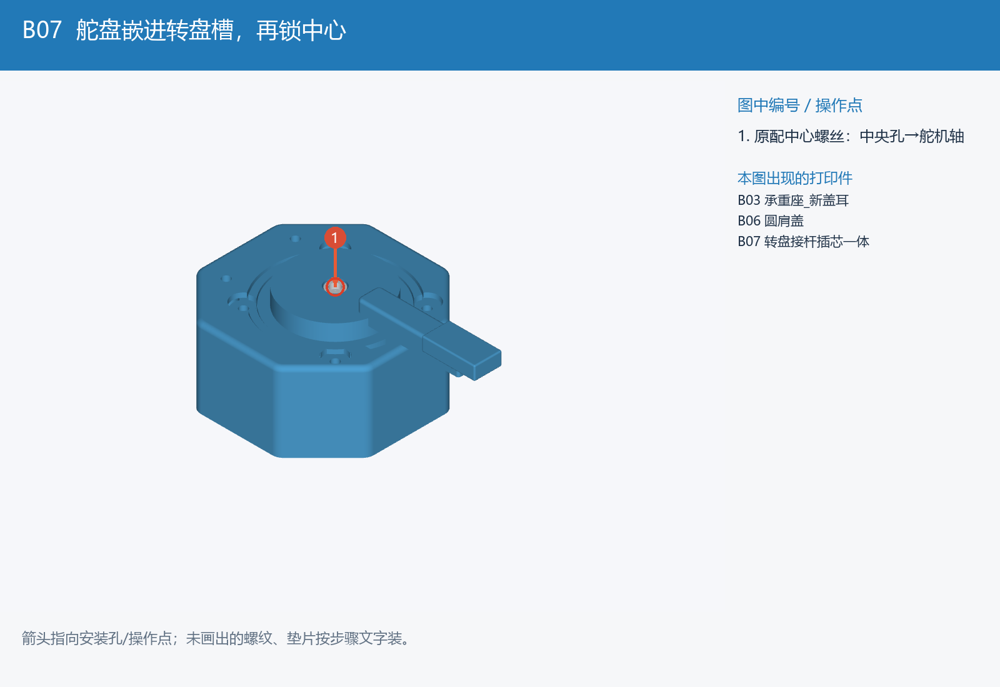

1. 先在桌上试B07底面的舵盘形状槽，舵盘必须贴入槽内；不能靠压环把不匹配的舵盘硬压下去。
2. 将舵盘/B07转盘组合对到舵机轴，转盘下部台阶落入B03承重座环口。
3. 从B07中央检修孔沿轴线，用原配中心螺丝把舵盘锁到输出轴；螺丝只锁舵盘，不能拉歪转盘。

装完检查：转盘落座、轴心同心，原配中心螺丝未顶底；此时还没有手掌。
舵盘负责传扭矩，外圈承重座承受手掌重量。花键不合或舵盘凸起时不要继续。

## B08 两半压环扣住转盘边缘

准备：M3×8 半圆头螺钉 ×4；使用B03步骤的4颗普通螺母

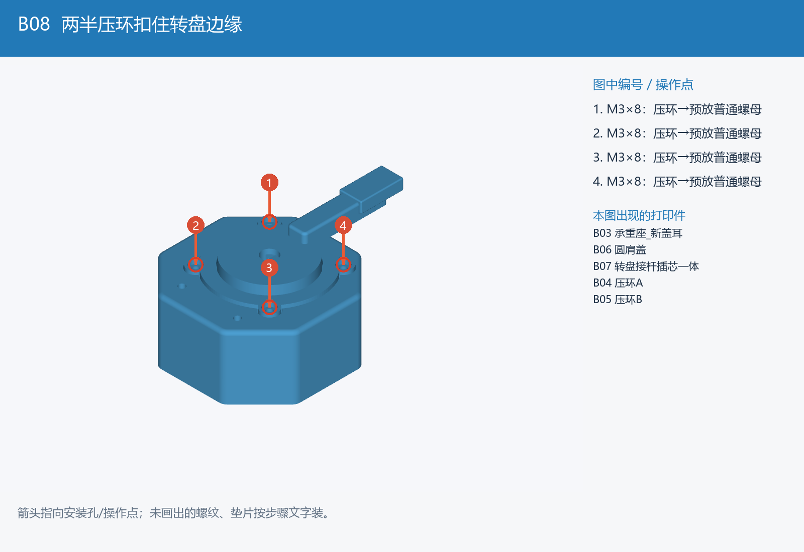

1. 把B04/B05两半压环从转盘两侧放好，使它们压住转盘的限位边缘。
2. 图中4孔向下各装1颗M3×8，拧到下方预放普通螺母。先对角轻带，再逐渐贴合。
3. 断电检查转盘无明显上下抬起；有阻力不能强扭舵机，先松开压环检查毛刺和装配间隙。

装完检查：压环固定但不夹死转盘；螺丝头不与接杆干涉。

## B09 蓝色头部整组装到身体

准备：M3×8 半圆头螺钉 ×4

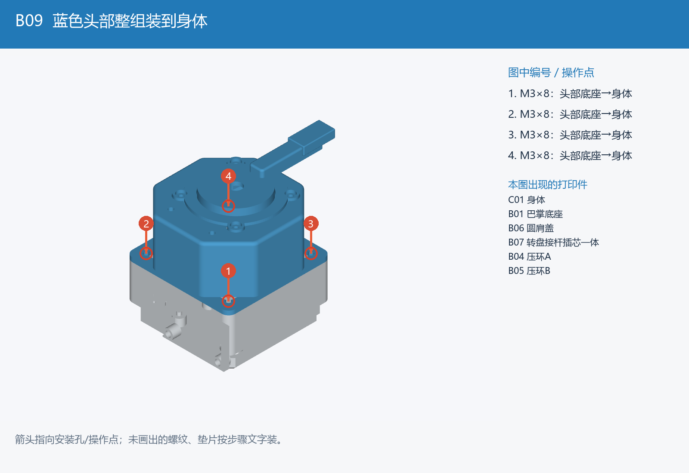

1. 先把攻击线从底座内部送进身体，接至已验证的D1转接线，断电核对G/V/S。
2. 头部底座落在身体顶部，四角孔对上身体顶部预装铜螺母；检查内部压臂没有压坏主板/线。
3. 从盖子外侧四个露出的角孔向下拧M3×8。先全部起牙，再交替锁紧；接杆挡工具时转开接杆。

装完检查：头部不晃，四角贴合，开关/USB保持可操作。
先不粘大手掌，四角螺丝更容易接近。

## B10 最后才把手掌粘到一体接杆上

准备：B08手掌；少量502/适用胶；无插销、无腕部螺丝

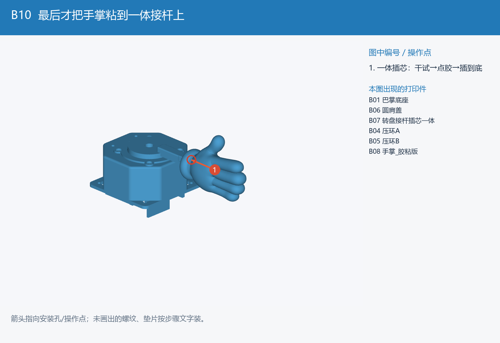

1. 把B08手掌的腕部槽先套上B07一体插芯，干试到底，手掌朝向按外观图对齐。
2. 确认没有支撑残渣或干涉，再取下，仅在插芯粘接面薄薄点胶，重新推到底并保持到初固。
3. 不要把胶滴进转盘、压环或舵机轴；完全固化后再测试。

装完检查：手掌与接杆不歪、不松；没有使用旧版黄色插块或横向销。

## R01 电机减速器先固定在红色底座

准备：完整LA024电机+LA016减速器；约2.5mm扎带 ×2

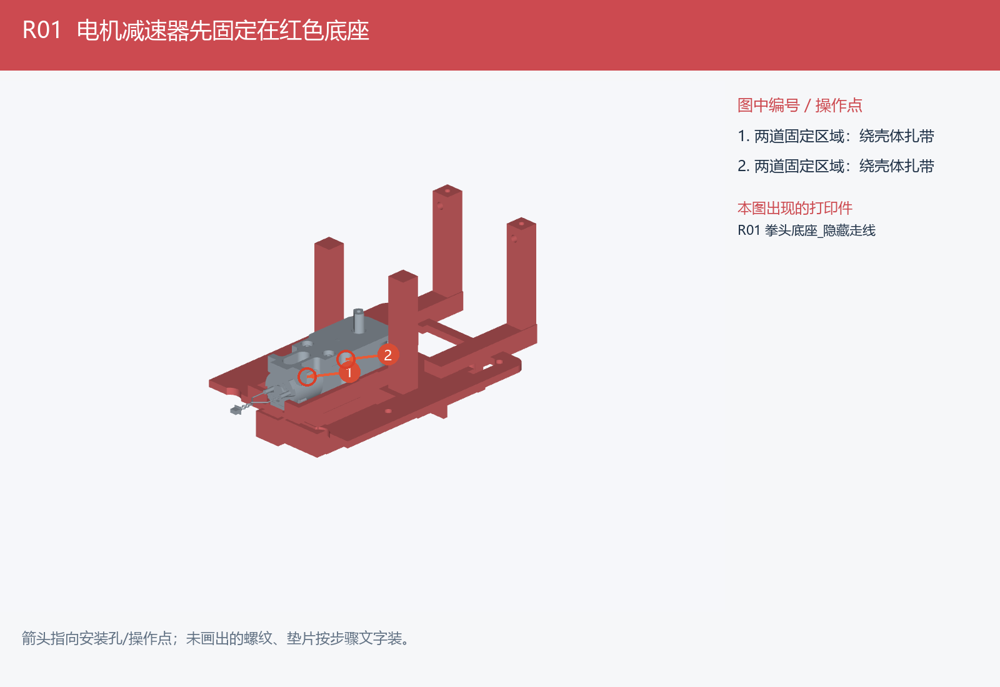

1. 先准备已经组装完整、可运转的减速电机。打印出来的两半壳不是完整减速器，内部还需原配齿轮和轴。
2. 整组放进R01底座的电机托位，减速输出轴朝上、电机尾部朝后。
3. 两根扎带从托位的绑扎通路绕住壳体收紧；尾部电线先穿底座隐藏走线口向下，不从身体接缝夹出。

装完检查：减速器不抬起、不转动，扎带不碰输出轴和后续连杆。
本图对应完整原配减速总成；内部齿轮尚未装好的，先沿原配减速器说明装好，不凭这张外形图猜齿轮顺序。

## R02 桌上先连接曲柄与连杆

准备：M3×16低头 ×1；2mm隔套 ×1；薄垫圈 ×2；M3防松螺母 ×1

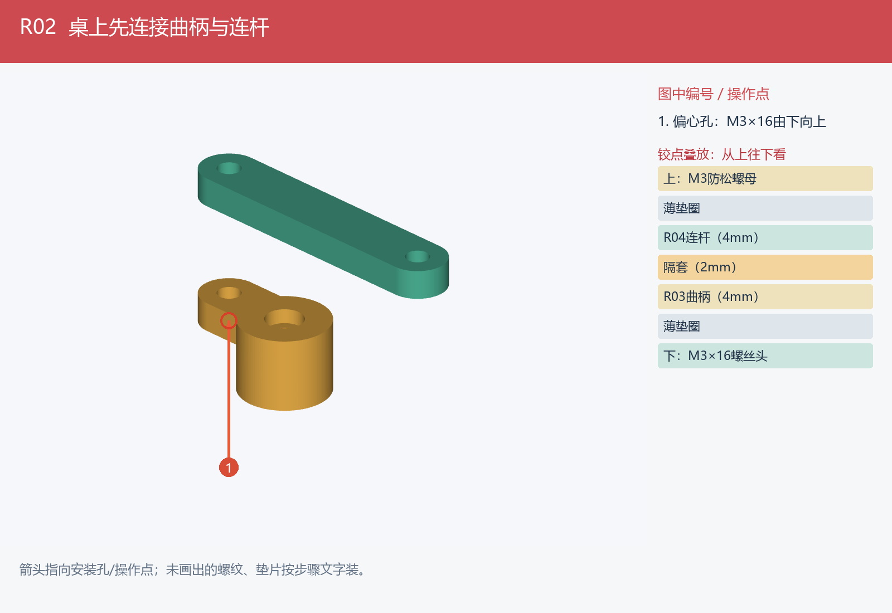

1. 此步在桌上进行，曲柄暂时不要套到电机轴上，否则底部可能不好送螺丝。
2. 从下向上按右图顺序穿：螺丝头→薄垫圈→R03曲柄偏心孔→2mm隔套→R04连杆端孔→薄垫圈→防松螺母。
3. 曲柄有两个孔：中心大轴套是电机轴位置，离中心10mm的偏心孔才连接杆。
4. 一手固定螺丝，一手慢慢拧防松螺母；消除明显上下晃动后停止，连杆必须仍能自由转动。

装完检查：活动铰点能摆动；不能把连杆夹死在曲柄上。
本图将连杆抬高12mm便于看孔；实际叠层之间只放2mm隔套。

## R03 再连接连杆的另一端与滑架

准备：M3×25低头 ×1；2mm隔套 ×1；薄垫圈 ×2；M3防松螺母 ×1

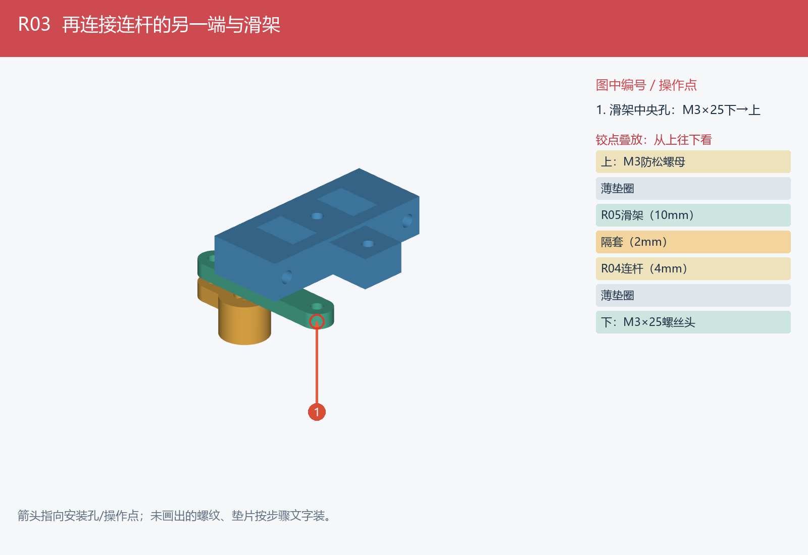

1. 保持上一步的曲柄—连杆组合，拿R05滑架，长舌头朝拳头前方。
2. 从下向上穿：螺丝头→薄垫圈→R04另一端孔→2mm隔套→R05滑架中央孔→薄垫圈→防松螺母。
3. 慢慢收紧到没有明显旷量但仍可转动。连杆在滑架下方，不要把它翻到滑架上面。

装完检查：两处铰点都能转动，滑架舌头朝前。
本图将滑架抬高12mm便于看孔；实际连杆与滑架之间只放2mm隔套。

## R04 整组放下，曲柄对准减速输出轴

准备：暂不加螺丝；先对形状干试

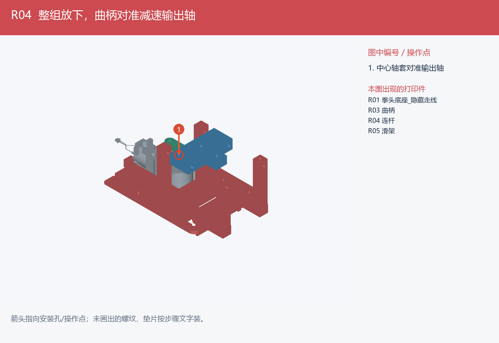

1. 把上一组曲柄—连杆—滑架抬到R01上方。
2. 曲柄中心的双扁位孔对上减速器输出轴，轻轻套到底；滑架放在两导杆支座之间。
3. 不要用锤子敲，也不要把曲柄偏心孔错套到输出轴。轴套太紧先清除毛刺并核对形状。

装完检查：曲柄坐到位，滑架在两条导杆的中间，连杆仍在滑架下方。

## R05 两根导杆从前穿入滑架

准备：Ø3×64mm光滑金属杆 ×2

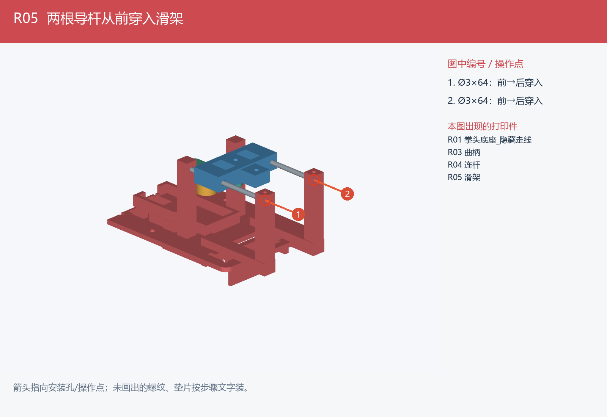

1. 从拳头方向的前支座穿入一根金属杆，再穿过滑架侧孔，最后进入后支座盲孔。
2. 另一侧同样操作；滑架先位于两支座之间，不要先把两根杆装死再想放滑架。
3. 用手轻推滑架，确认沿杆顺滑；需要时松开尚未固定的曲柄调整，不能暴力顶减速齿轮。

装完检查：两杆平行、均进入后座，滑架不歪、不涩。

## R06 锁住导杆，再固定输出轴中心

准备：M3×4紧定螺钉 ×2；输出轴原配中心锁紧螺丝 ×1

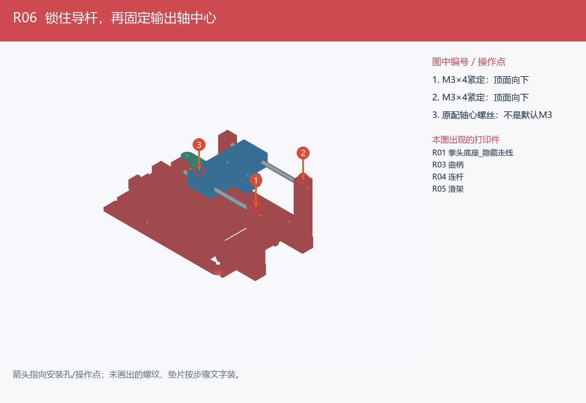

1. 前支座上方两只Ø2.6底孔需先攻M3牙、清干净屑，再装M3×4紧定螺钉；轻压住金属杆，别拧裂支座。
2. 通过曲柄中心孔，用与减速输出轴实际螺纹匹配的原配中心螺丝锁住曲柄。
3. 两处滑架/连杆活动螺母不再加紧。检查导杆不串出、曲柄不会从输出轴抬起。

装完检查：导杆固定、曲柄轴向不脱落，两个铰点仍自由。
中心通孔Ø2.7不能证明输出轴是M2.5或M3螺纹。沿用已运行旧机的原配螺丝，拿不准时先停在这一步。

## R07 拳头腕杆插上滑架舌头并穿螺丝

准备：M3×18或×20 ×1；M3普通六角螺母 ×1

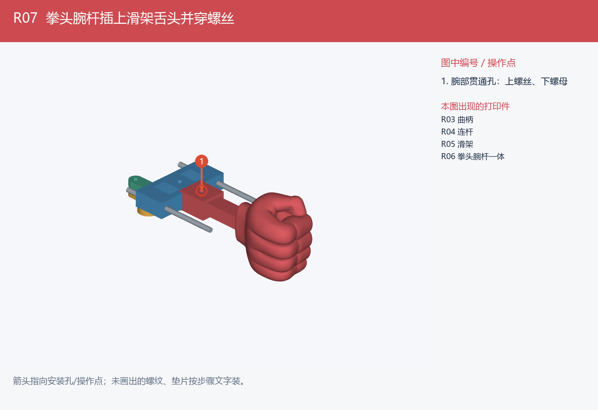

1. R06拳头腕杆的槽对准R05前伸舌头，从前方向后插到位。
2. 对齐腕部上下贯通孔，用M3×18或×20自上而下穿过腕杆与舌头，在底部配普通M3六角螺母。
3. 该处是固定连接，可以锁紧；按实际垫片选长度，螺母后露1–2牙即可，不让长螺丝碰其他结构。

装完检查：拳头固定、不扭摆；不要把本步与后方的活动铰点混淆。

## R08 封头前先检查一整圈行程

准备：不增加螺丝

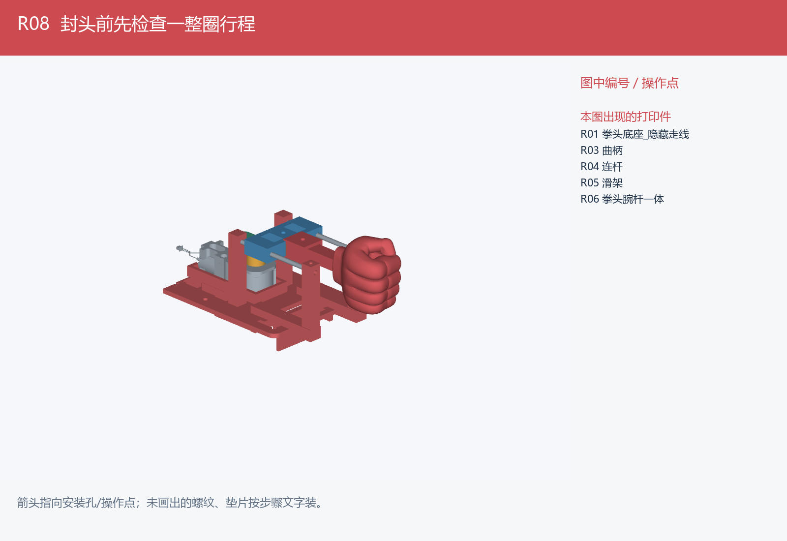

1. 断电下先检查两端极限和两处铰点，不强行反拖带阻力的减速器。
2. 确认拳头往复时不碰底座/护罩，连杆上下有隔套，螺丝尾部没有擦到固定结构。
3. 需要通电检验时固定底座、清空拳头前方，只做受控短时测试；卡住立刻断电处理。

装完检查：约20mm往复行程通畅，再装身体；不能靠电机硬磨通卡点。

## R09 先把底座放到身体，护罩一起对孔

准备：本步先穿线和对孔

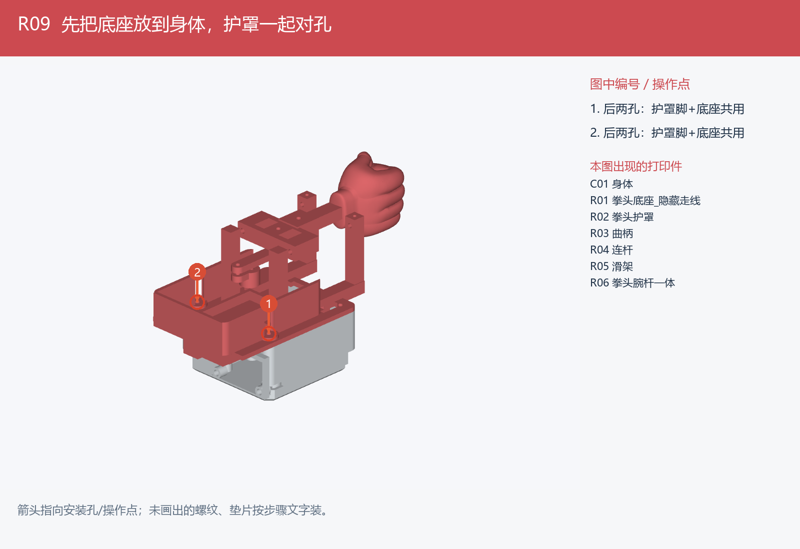

1. 将电机线从底座尾部隐藏口向下送入身体，断电接到M1。
2. R01底座落到身体顶部，四角孔对齐；主板托架上方不压线。
3. 放上R02护罩：后方两个罩脚与身体后方两孔共用螺丝，不另找旧版悬空耳孔。

装完检查：四孔全部对正，后两个孔上有护罩脚，前两个孔没有。

## R10 前面两颗8mm，后面两颗10mm

准备：前：M3×8 ×2；后：M3×10 ×2

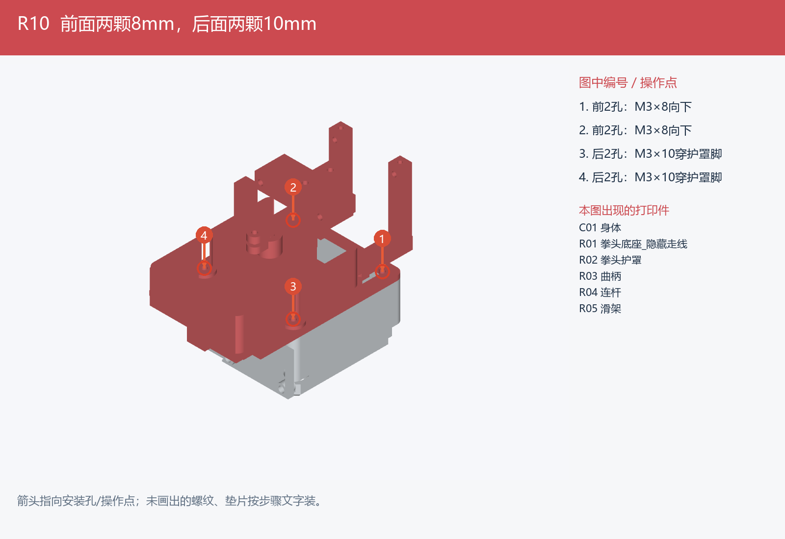

1. 先在前方两孔各轻拧1颗M3×8，穿R01底座进入身体铜螺母。
2. 再从后方护罩敞口向下，各拧1颗M3×10，穿护罩脚+底座进入身体铜螺母。
3. 四颗都起牙后再交替锁紧；检查底座四角贴合、M1线没有夹在接缝里。

装完检查：红色头部和护罩固定，后USB与开关仍可操作。

## Z01 最后检查，再做短时开机

准备：无新增螺丝

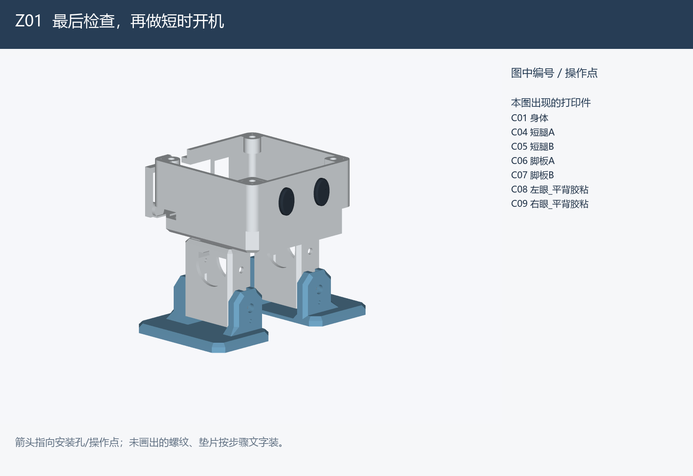

1. 检查所有结构螺丝贴合；两个拳头活动铰点仍可转；巴掌转盘没有被压环夹死。
2. S1左髋、S2左踝、S3右髋、S4右踝；蓝机D1攻击舵机、红机M1电机。接线按板端标识和已验证转接线。
3. 先托住机器人进入站姿，确认左右脚方向、无顶死，再落地试行走；随后单独试攻击，最后组合。
4. 松杆应停，K4按住跳舞、松开恢复；本项目K4已不是急停，异常用实体电源开关断电。

装完检查：机械、电气、动作分别确认，不把“拧得上”当作“动作已验证”。
这是按现有v11送印模型核对的教程；新到舵机/五金的实物公差和实际安装效果仍需当场确认。